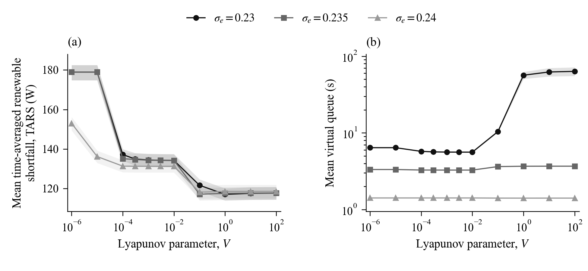

# Section 5.3：V 实验的当前唯一图件

本版按用户 2026-11-25 的要求，默认采用 **决策端只调用三个 MLP mean、决策 PV=最近有效实测功率×mT、阶段权重 (100,10,1)**。只更新 V 敏感性实验，当前图集只保留以下 a、b 双联图；不生成额外 V/frontier 图，也不重新运行权重方案比较。旧 Section 5.3 图和结果属于历史信息模式，不作为当前论文 V 图。



[论文 PDF](figures/figure9_V_ab.pdf) · [可编辑 SVG](figures/figure9_V_ab.svg) · [600 dpi TIFF](figures/figure9_V_ab.tiff) · [全部 33 个图中参数点](source_data/figure9_V_ab.csv)

## 1. 实验与默认信息规则

- 冻结的全量 260K simulator，三个 MLP、600 条原始 profiling 观测形成的经验噪声库，action=32/64/128/256/512，K=3。没有重新拟合模型或修改 J、phase 阈值。
- 固定权重为 (100,10,1)。V={1e-06, 1e-05, 0.0001, 0.0003, 0.001, 0.003, 0.01, 0.1, 1, 10, 100}，σe={0.23,0.235,0.24}；保留原图的全部 11 个 V 点，不选择或隐藏某个参数点。
- 240 个非连续日期，2025-07-13—2026-04-11，北京时间午夜起点；每次 30 task×4 epoch；每日期每配置 32 个配对种子 120000–120031。共 **253,440 次新运行、30,412,800 个模拟 epoch**。
- 所有配置共用 PV70 倍率 α=4.1928776597152995。它由原 48 个调参日和参考 GPU 功率校准，全部 240 天的平均比例约为 72.29%；本次不重新选择日期、PV scale 或权重。
- PV 统一通过 PVDatabase 取得，环境沿用本场景明确指定的官方无限跨缺口线性插值。45 天含超过五分钟的支撑间隔。195 天、142 天及原 192 天留出子集仅提供数值表，不增画图件。

决策端的输入是当前 J、phase、Q、候选 action 的三个均值，以及最近有效实测功率 P_last。对每个 action：

```text
estimated_PV = P_last * m_T
estimated_shortfall = max(m_dem - estimated_PV, 0)
score = (V * estimated_shortfall + w_phase * Q * (m_epsilon - sigma_e * m_T)) / m_T
action = argmin(score)
```

P_last 已乘相同 α，只允许使用时间戳不晚于决策时刻的真实观测；无新观测时持有旧值并记录 age。控制器不访问噪声库，不读取未来曲线，不积分；上述短缺是均值代入预测，不是实际短缺的精确条件期望。

环境在动作选定后生成 mean＋noise 的实际时长、需求和误差，再计算实际 epoch 窗口的 PV 积分及净能量短缺。实际响应更新 J、phase、Q 和时钟。每 task 重置训练状态，Q 和时钟跨 task 保留。数据长中断会导致陈旧观测，未用未来插值替代；其影响仍属于本实验的资料限制。

## 2. 图中两个量怎样计算

每次运行的 `TARS = sum(actual_shortfall_J) / sum(actual_T_s)`；`mean_Q = mean(Q_before_s)`，对 120 个 epoch 起点等权平均。Q 的单位为秒，是虚拟约束积压量，不是实际作业排队等待时间，也不是时长加权 Q。

先对每个日期的 32 次重复取均值，再对 240 天等权平均。阴影为 2,000 次配对日历周 cluster bootstrap 的逐点 95% 区间，所有参数共用重采样索引；没有把模拟 epoch 当成独立实测样本。区间条件于冻结模型和插值假设，不含 MLP 拟合误差、缺口内未知天气或动态 batch 的真实训练验证误差。

## 3. 结果与解释

在 **σe=0.235，V 从 0.01 到 0.1** 时，平均 TARS 从 **134.241304 W** 降到 **117.159479 W**，降低 **12.7247%**，95% 配对区间为 **[11.1835%, 14.1677%]**；平均 Q 从 **3.270740 s** 增到 **3.631603 s**，增加 **0.360863 s**，95% 区间 **[0.315463, 0.405855] s**。两种设置均未观察到超约束运行。

| σe | V | Mean TARS (W) | Mean Q (s) | Mean DWAE | 超约束 / 7680 |
|---:|---:|---:|---:|---:|---:|
| 0.23 | 0.01 | 134.258031 | 5.603779 | 0.224325 | 0 |
| 0.23 | 0.1 | 121.666255 | 10.392951 | 0.228222 | 9 |
| 0.23 | 1 | 117.070971 | 56.480870 | 0.230262 | 3213 |
| 0.235 | 0.01 | 134.241304 | 3.270740 | 0.224323 | 0 |
| 0.235 | 0.1 | 117.159479 | 3.631603 | 0.230128 | 0 |
| 0.235 | 1 | 117.563334 | 3.671005 | 0.230532 | 0 |
| 0.24 | 0.01 | 131.257731 | 1.415541 | 0.224010 | 0 |
| 0.24 | 0.1 | 118.170992 | 1.409912 | 0.229957 | 0 |
| 0.24 | 1 | 118.573306 | 1.408661 | 0.230315 | 0 |


σe=0.23 的较大 V 出现明显队列增长，但不能把所有点称作可行 frontier：V=0.1、1、10、100 分别有 9、3213、3625、3671 次 DWAE 超过 0.23。σe=0.235 和 0.24 的全部网格设置均未观察到超约束。σe=0.24 下队列基本不随 V 增长；不将其描述为强队列权衡。

图中连接线只是相邻已测试 V 的阅读辅助，不拟合平滑曲线；高 V 下动作趋于饱和、局部非单调结果均保留。权重从旧图 (1,1,1) 改为 (100,10,1)，加上信息模式变化，曲线转折位置不要求与旧图相同。

本次仅做预先指定网格的敏感性评估，没有新增 V 调优或把评估结果用来选择展示日。原 192 个非校准日期和质量子集结果见 `results/summary.csv`。这张图本身不承担权重方案优越性比较。

## 4. 验证与复现

- 全部 240 日期的历史观测查找和官方 PV 积分一致性核验通过。
- 三个 σe 的 **4,320 个 epoch** 经独立 Python 动作和环境轨迹重放，全部有非零环境噪声。
- 独立控制器只提供两个模型 JSON、不提供噪声库文件，完成 99 组 σe/V/状态决策核对。改变环境噪声或未来 PV 不会改变固定输入下的决策。
- σe=0.24、V=0.1 的 **全部 240 天×32 种子**与当前 Section 5.2 逐运行一致，所核对指标最大差为 0。
- 所有运行在一天内完成，有限窗口关系 `DWAE <= sigma_e + Q_end / total_T` 逐运行通过；该关系不是逐运行满足原 σe 的保证。
- 模型、PV 数据库、Section 5.2 和历史 Section 5.3 的源文件哈希均保持不变。

```bash
python experiment.py prepare
python verify_engine.py
python experiment.py evaluate --workers 3
python analyze.py
python plot_figure.py
python write_report.py
python finalize.py
```

日期结果原子保存，可以从完成的日期继续；代码、协议、模型或 PV 哈希变化时拒绝复用缓存。`figures/` 只有 `figure9_V_ab` 的四种导出格式。`results/evaluate/` 保存逐日原始运行，`source_data/` 保存全部逐日均值及图中点。论文图注见 `FIGURE_CAPTIONS.md`，核验见 `verification.json` 和 `FIGURE_QA.md`。
