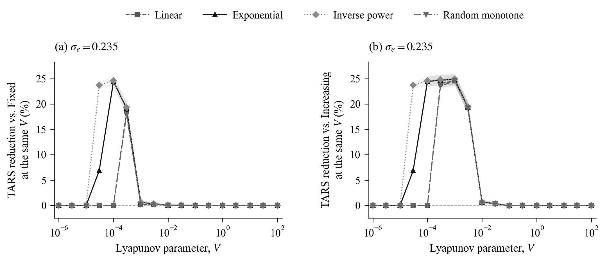

# Weight-decay 同 V 比较：合并图 (a,b)

(a) 相对 Fixed=(100,100,100)；(b) 相对 Increasing=(100,1000,10000)。按用户要求将已完成的两幅图组成横向双联图，未新增模拟或改变统计结果。

[PDF](figures/weight_decay_sameV_ab.pdf) · [SVG](figures/weight_decay_sameV_ab.svg) · [600 dpi TIFF](figures/weight_decay_sameV_ab.tiff)

两个面板采用完全相同的横纵坐标范围、字体、灰度线型和共享图例。每幅保留四条曲线各 17 个点，共 136 个点，以及原有逐点 95% 置信区间；负值和零值未删除。绘图直接读取已验证的数值表，保留可编辑矢量文字和曲线。

参数仍为 sigma_e=.235、240 日期、32 配对种子、每次 30 task×4 epoch、PV70；决策仅访问 MLP mean 和最新历史 PV 功率，环境保留经验联合噪声与实际窗口 PV 积分。来源和详细解释见 [Fixed 实验](../260k-section53-weight-sameV/README.md) 与 [Increasing 实验](../260k-section53-weight-sameV-increasing/README.md)。同一 decay 运行用于两个面板，不能将两个面板当作独立重复。

图片尺寸 7.2×3.2 inch，Times New Roman 9–10 pt。运行 `python plot_figure.py` 重建。源 CSV 按字节复制并校验，来源哈希记录在 source_manifest.json；导出验证见 verification.json。
