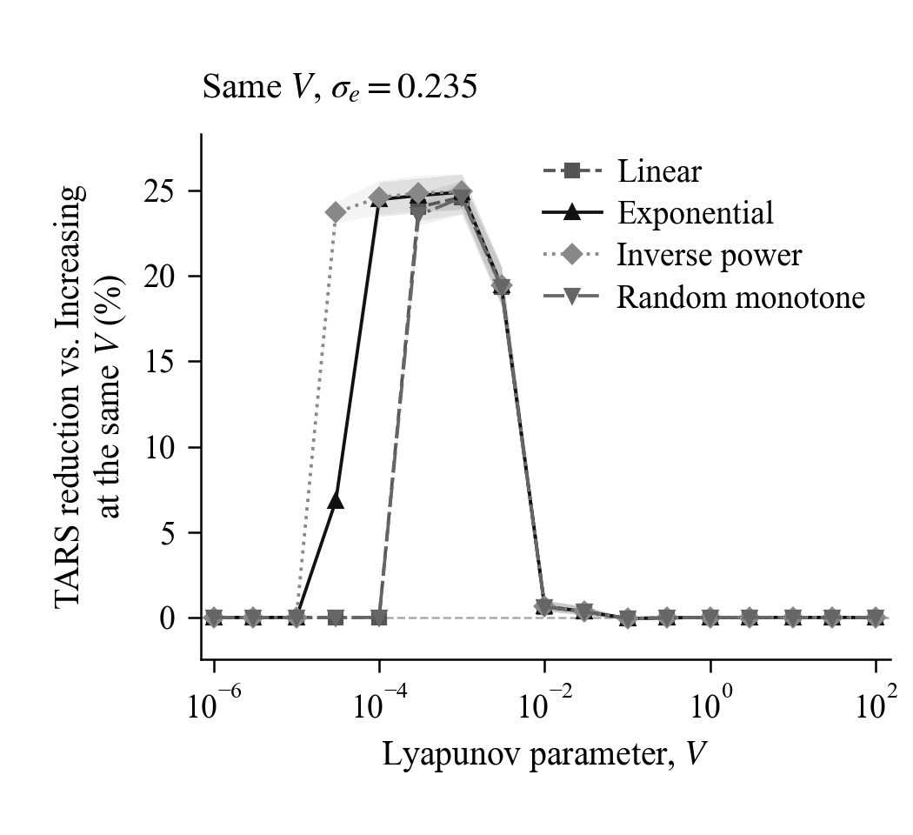

# Section 5.3：同 V 下，weight decay 相对 Increasing 的改善

这是原有 [相对 Fixed 图](../260k-section53-weight-sameV/README.md) 的配套版本，两张图均保留。**唯一实验变化是把比较基准改为 Increasing=(100,1000,10000)**；不是 batch size 递增的 INC baseline。



[论文 PDF](figures/weight_decay_sameV_increasing.pdf) · [可编辑 SVG](figures/weight_decay_sameV_increasing.svg) · [600 dpi TIFF](figures/weight_decay_sameV_increasing.tiff)

## 结果

在共同 V=10⁻³ 下，四种 decay 相对 Increasing 的全 240 天平均 TARS 降低 **24.59%–24.94%**。相对 Fixed 的上一张图，共同收益区间延伸到更大的 V。这里保留全部 17 个 V 点，并未只画有利区间。

| decay_family | increasing_TARS_W | decreasing_TARS_W | gain_percent | gain_ci_low_percent | gain_ci_high_percent |
| --- | --- | --- | --- | --- | --- |
| Linear | 178.901 | 134.878 | 24.6075 | 23.6254 | 25.607 |
| Exponential | 178.901 | 134.334 | 24.9113 | 23.9001 | 25.9609 |
| Inverse-power | 178.901 | 134.29 | 24.936 | 23.9304 | 25.9796 |
| Random-monotone | 178.901 | 134.915 | 24.5867 | 23.6037 | 25.588 |

在 V=.1 时，递减权重反而略差，TARS 降幅为 **−0.060479%**，逐点 95% 区间约为 [−0.122593%, −0.003297%]。V=.3 时差异为 −0.024695%，区间包含零。图上这些点非常接近零线，但未删除或截断；精确值见下表。

| decay_family | V | gain_percent | gain_ci_low_percent | gain_ci_high_percent |
| --- | --- | --- | --- | --- |
| Linear | 0.1 | -0.0604786 | -0.122593 | -0.00329742 |
| Exponential | 0.1 | -0.0604786 | -0.122593 | -0.00329742 |
| Inverse-power | 0.1 | -0.0604786 | -0.122593 | -0.00329742 |
| Random-monotone | 0.1 | -0.0604786 | -0.122593 | -0.00329742 |
| Linear | 0.3 | -0.0246951 | -0.0531642 | 0.00442782 |
| Exponential | 0.3 | -0.0246951 | -0.0531642 | 0.00442782 |
| Inverse-power | 0.3 | -0.0246951 | -0.0531642 | 0.00442782 |
| Random-monotone | 0.3 | -0.0246951 | -0.0531642 | 0.00442782 |

因此，本图支持特定小 V 区间的同 V 优势和参数敏感性改善，不能表述为所有 V 下更好。各策略分别选择已评估网格内最佳 V 后，Increasing 的 TARS 反而略低；差异很小。

| weight_schedule | V | mean_TARS_W | mean_DWAE | violations |
| --- | --- | --- | --- | --- |
| Exponential | 0.1 | 117.159 | 0.230128 | 0 |
| Increasing | 0.1 | 117.089 | 0.230136 | 0 |
| Inverse-power | 0.1 | 117.159 | 0.230128 | 0 |
| Linear | 0.1 | 117.159 | 0.230128 | 0 |
| Random-monotone | 0.1 | 117.159 | 0.230128 | 0 |

## 设置与复用

- sigma_e=.235；V 从 10⁻⁶ 到 10²，按每个数量级 1×、3×取值，共 17 点，完全沿用前图。未重新调参。
- Linear=(100,50.5,1)；Exponential=(100,10,1)；Inverse-power=(100,5.471929494104974,1)；Random-monotone=(100,56.298646422323216,1)。随机中间权重由 seed=2026112305 抽取一次，之后固定。公式和完整参数见 protocol.json。
- Increasing=(100,1000,10000)，对应 100×10^(k−1)，沿用此前已定义的对照，不另选较弱的参数。各组初始权重相同，总权重不匹配；K=3，四种 decay 仅中间权重不同。这里的阶段权重不是优化器 L2 weight decay。
- 260K 全量冻结模拟器；action=32/64/128/256/512；每运行 30 task×4 epoch。
- 全部 240 日期，各自从 Asia/Shanghai 00:00 开始；每日期每配置 32 个配对种子 120000–120031。任务重置模型状态，日期内 PV 时钟和队列连续。
- PV70 的同一倍率 α=4.1928776597152995；调用同一 PVDatabase 和官方无限跨缺口插值。没有按曲线调整日期、倍率、天气或缺口规则。
- 决策仅用 MLP mean；PV 预测为最新历史实测功率×mT；不读取噪声库、不读取未来 PV、不作决策积分。环境使用 mean＋经验联合噪声，实际 PV 按实际 epoch 时段积分。
- 比较共 **652,800 次运行、78,336,000 个模拟 epoch**。直接复用前图的 522,240 次 decay 运行，以及此前 V=.1 的 7,680 次 Increasing 运行；只新增其余 16 个 V 的 **122,880 次 Increasing 运行**。
- 全部比较运行均在一天内完成，最长 21.294762 小时；未观察到 DWAE>.235，最大 DWAE=0.233569203。不将“未观察到违约”解释为真实违约概率为零。

## 完整网格结果（降幅 %）

| V | Linear | Exponential | Inverse-power | Random-monotone |
| --- | --- | --- | --- | --- |
| 1e-06 | 0 | 0 | 0 | 0 |
| 3e-06 | 0 | 0 | 0 | 0 |
| 1e-05 | 0 | 0 | 0 | 0 |
| 3e-05 | 0 | 6.83809 | 23.6997 | 0 |
| 0.0001 | 0 | 24.4707 | 24.5919 | 0 |
| 0.0003 | 24.026 | 24.7005 | 24.8462 | 23.5497 |
| 0.001 | 24.6075 | 24.9113 | 24.936 | 24.5867 |
| 0.003 | 19.3478 | 19.4323 | 19.4479 | 19.3272 |
| 0.01 | 0.617568 | 0.652123 | 0.652123 | 0.614737 |
| 0.03 | 0.343204 | 0.348928 | 0.348928 | 0.336699 |
| 0.1 | -0.0604786 | -0.0604786 | -0.0604786 | -0.0604786 |
| 0.3 | -0.0246951 | -0.0246951 | -0.0246951 | -0.0246951 |
| 1 | 0.000349469 | 0.000349469 | 0.000349469 | 0.000349469 |
| 3 | 0 | 0 | 0 | 0 |
| 10 | 0 | 0 | 0 | 0 |
| 30 | 0 | 0 | 0 | 0 |
| 100 | 0 | 0 | 0 | 0 |

## 统计与核验

先对每日期内 32 个种子平均，再对日期等权平均。纵轴是 `100 × (mean TARS_Increasing − mean TARS_decay) / mean TARS_Increasing`，分子和分母始终来自相同 V。所有分母严格为正。阴影为 2,000 次配对日历周 cluster bootstrap 的逐点 95% 区间，不是覆盖全部曲线的同时置信带；无额外多重检验或 p 值声明。

报告还保留原 192 个非 PV 校准日期及 195/142 天质量子集数值，主图始终使用全 240 天；这些此前查看过的日期不是新的盲测集。本次没有重新训练或划分 MLP 数据，是冻结全量模拟器内的策略比较。区间不包含 MLP 拟合误差、缺口内未知天气或真实动态切换误差。

新增 Increasing 独立 Python 重放覆盖 3 日期×5 个 V×120 epoch=**1,800 epoch**，核对模型、动作、阶段权重、实际噪声、历史观测、官方 PV 能量、队列与保存结果。决策验证只提供两个模型 JSON，不提供噪声文件。四种 decay 的原有独立验证继续适用；核心源代码哈希一致。复用的 7,680 次 Increasing 运行与原始结果比较的最大误差为 0。

`results/increasing_runs.csv.gz` 保存完整 Increasing 对照；decay 原始运行直接引用前图的不可变结果，来源哈希写入 protocol.json。`source_data/sameV_curves.csv` 保存全部 68 个配对点与区间，`source_data/absolute_metrics.csv` 保存全部 85 配置的绝对性能和可行性。

```bash
python experiment.py prepare
python experiment.py evaluate --workers 3
python analyze.py
python verify.py
python plot_figure.py
python write_report.py
python finalize.py
```

图采用与 Fixed 版本相同的 OR 灰度样式、Times New Roman、3.5×3.2 inch 单栏尺寸。当前 V 的 a,b 图不变。
