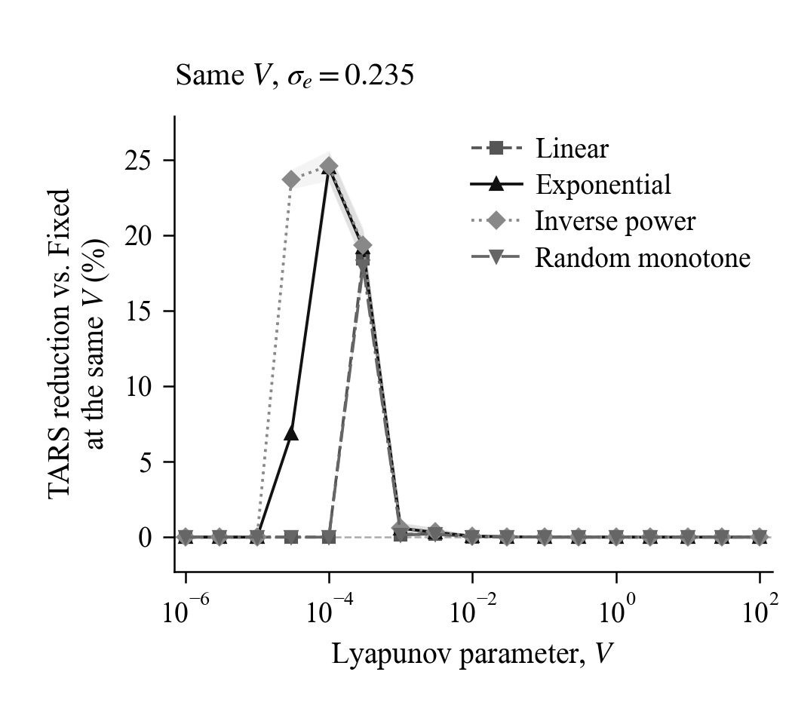

# Section 5.3：同一个 V 下，weight decay 相对 Fixed 的改善

**本次按用户提供图的形式，放弃固定 V=0.1 的展示，改为 sigma_e=0.235 下完整扫描 V。** 图确实显示出四种 decay 在小 V 区间的共同优势：在相同 V=3×10⁻⁴ 下，全 240 天平均 TARS 降低 **17.94%–19.33%**；指数和反幂在 V=10⁻⁴ 处的网格内最大降幅约为 **24.5%**。



[论文 PDF](figures/weight_decay_sameV.pdf) · [可编辑 SVG](figures/weight_decay_sameV.svg) · [600 dpi TIFF](figures/weight_decay_sameV.tiff)

这个结果支持“**递减权重缓解小 V 下的性能损失，降低对 V 选择的敏感性**”。它不支持“任意 V 下严格更好”或“分别选择最佳 V 后还有约 20% 优势”。极小和较大的 V 下，性能差异回到零附近。完整 17 点曲线保留这些区域。

## 1. 图的定义与实验设置

纵轴为 `100 × (mean TARS_Fixed(V) − mean TARS_decay(V)) / mean TARS_Fixed(V)`。**每个点都与相同 V 的 Fixed 对照**，没有拿 decay 的最佳 V 去比较 Fixed 的差 V。

- 按用户给出的参考图固定 sigma_e=0.235。这是此前结果之后的探索性后续实验，选择来源明确记录，不作为从未查看过的数据上的独立确认。
- V 网格在评估前固定：每个十进制数量级取 1×和 3×，从 10⁻⁶ 到 10²，共 17 点。完整数值为 `1e-06, 3e-06, 1e-05, 3e-05, 0.0001, 0.0003, 0.001, 0.003, 0.01, 0.03, 0.1, 0.3, 1, 3, 10, 30, 100`。未按曲线结果删去低收益区域或仅绘制峰值附近。
- 沿用上一版四个 decay 函数及数值尺度，不切换到参考截图中历史的归一化权重。所有组 w1=100；四种 decay 的 w3=1。Fixed=(100,100,100)。本图只比较 Fixed，不包含 Increasing。

| Schedule | w1 | w2 | w3 |
|---|---:|---:|---:|
| Linear | 100 | 50.500000 | 1 |
| Exponential | 100 | 10.000000 | 1 |
| Inverse-power | 100 | 5.471929 | 1 |
| Random-monotone | 100 | 56.298646 | 1 |
| Fixed | 100 | 100.000000 | 100 |


线性函数为 `100−99(k−1)/2`；指数为 `100 exp[−ln(100)(k−1)/2]`；反幂为 `100 k^(−ln(100)/ln(3))`。随机单调曲线按预定种子 2026112305 抽取一次 log-uniform 中间权重，全部日期和运行共用该数值。K=3 且首尾相同，四种 decay 只在中间阶段权重上有区别。

- 决策仍只调用三个 MLP mean，PV 预测=最近有效真实观测功率×mT，不访问噪声库、不看未来、不做决策积分。
- 环境仍为冻结全量 260K mean＋经验联合噪声，实际 PV 能量按实现的 epoch 窗口积分。J、phase、模型和噪声库均未重新拟合。
- 240 个非连续日期，从北京时间 00:00 开始；每运行 30 task×4 epoch；每日期每配置 32 个配对种子 120000–120031。
- 同一 PV70 α=4.1928776597152995，官方无限跨缺口插值；没有改变 PV 容量或挑选天气日，保留原有缺口与陈旧观测限制。
- 5 个 schedule×17 个 V=85 个配置，**652,800 次新模拟运行、78,336,000 个模拟 epoch**。
- 所有配置均完成于一天内，所有 **652,800 次运行未观察到 DWAE>0.235**；最大 DWAE 为 0.23354147。这不代表未来违约概率为零。

## 2. 同一个 V 的直接对照

在 V=3×10⁻⁴ 下，四种 decay 都有明显改善，而不是各取不同 V 的最大值：

| decay_family | fixed_TARS_W | decreasing_TARS_W | gain_percent | gain_ci_low_percent | gain_ci_high_percent |
| --- | --- | --- | --- | --- | --- |
| Linear | 166.667 | 135.918 | 18.4495 | 17.5812 | 19.3494 |
| Exponential | 166.667 | 134.711 | 19.1735 | 18.0917 | 20.2906 |
| Inverse-power | 166.667 | 134.451 | 19.3299 | 18.202 | 20.4895 |
| Random-monotone | 166.667 | 136.77 | 17.9383 | 17.304 | 18.5924 |

这些是完整网格中一个共同 V 的描述性对照。四种 decay 的配对逐点区间下界都为正。在已测试的 V={0.0003,0.001,0.003,0.01,0.03} 上，四种 decay 的点估计与逐点区间下界均为正，收益随 V 增大快速缩小；不把离散网格外的所有 V 都当成已验证。

## 3. 网格内峰值与范围

| decay_family | V | gain_percent | gain_ci_low_percent | gain_ci_high_percent |
| --- | --- | --- | --- | --- |
| Exponential | 0.0001 | 24.4707 | 23.4835 | 25.4911 |
| Inverse-power | 0.0001 | 24.5919 | 23.6086 | 25.5933 |
| Linear | 0.0003 | 18.4495 | 17.5812 | 19.3494 |
| Random-monotone | 0.0003 | 17.9383 | 17.304 | 18.5924 |

峰值是预先完整列出的网格中的描述性最大值，未经新的独立数据验证，不作为最优参数保证。指数/反幂较早开始产生收益，线性/随机曲线需要稍大的 V；这与不同的中期权重一致。没有改变曲线定义来凑出共同优点。

完整主图数值（百分比）：

| V | Linear | Exponential | Inverse-power | Random-monotone |
| --- | --- | --- | --- | --- |
| 1e-06 | 0 | 0 | 0 | 0 |
| 3e-06 | 0 | 0 | 0 | 0 |
| 1e-05 | 0 | 0 | 0 | 0 |
| 3e-05 | 0 | 6.83809 | 23.6997 | 0 |
| 0.0001 | 0 | 24.4707 | 24.5919 | 0 |
| 0.0003 | 18.4495 | 19.1735 | 19.3299 | 17.9383 |
| 0.001 | 0.181205 | 0.583393 | 0.616102 | 0.153589 |
| 0.003 | 0.215663 | 0.320247 | 0.339561 | 0.190163 |
| 0.01 | 0.0343751 | 0.0691333 | 0.0691333 | 0.0315275 |
| 0.03 | 0.0230308 | 0.0287736 | 0.0287736 | 0.0165054 |
| 0.1 | 0.000856436 | 0.000856436 | 0.000856436 | 0.000856436 |
| 0.3 | 0 | 0 | 0 | 0 |
| 1 | 0 | 0 | 0 | 0 |
| 3 | 0 | 0 | 0 | 0 |
| 10 | 0 | 0 | 0 | 0 |
| 30 | 0 | 0 | 0 | 0 |
| 100 | 0 | 0 | 0 | 0 |

全部网格点的平均 TARS 改善率非负，但大量点是完全相同的结果；例如 V≤10⁻⁵ 或 V≥0.3。V=0.1 时只有约 0.000856% 的差异，配对区间包含零。不能把“未见平均劣化”写成“处处严格更优”。

## 4. 与分别调好 V 的结果区分

下表只是完整已评估网格中各组的最低平均 TARS，属于事后描述，不据此发布新的调参策略：

| weight_schedule | V | mean_TARS_W | mean_DWAE | violations |
| --- | --- | --- | --- | --- |
| Exponential | 0.1 | 117.159 | 0.230128 | 0 |
| Fixed | 0.1 | 117.16 | 0.230128 | 0 |
| Inverse-power | 0.1 | 117.159 | 0.230128 | 0 |
| Linear | 0.1 | 117.159 | 0.230128 | 0 |
| Random-monotone | 0.1 | 117.159 | 0.230128 | 0 |

各组最低均值都出现在 V=0.1，decay 相对 Fixed 只改善约 **0.000856%**，区间包含零。因而本图的主要价值是说明**同 V 下小 V 区域的稳健性和参数敏感性**，不是证明重新调好 V 后的最优性能被明显改善，也不是全局 Pareto 优越性的证明。

## 5. 统计、验证和复现

先平均每日期的 32 次噪声重复，再对 240 日期等权平均。阴影为 2,000 次配对日历周 cluster bootstrap 的逐点 95% 区间；各曲线共用重采样索引。未对所有网格点构建同时覆盖置信带，未把模拟 epoch 当作独立实测样本。区间不包含 MLP 拟合误差、缺口内未知天气或真实动态 batch 切换误差。

原 192 个非 PV 校准日期以及 195/142 天数据质量子集仅在数值表中报告；它们已在此前分析中被查看，不能称为本次全新的盲测集。全 240 天始终是主图，未按效果选择子集。

独立 Python 重放覆盖五种权重、五个不同 V 和三个日期，共 **9,000 个 epoch**；独立决策只提供两个模型 JSON 文件。实际噪声、官方 PV 能量、模型均值、动作、Q 与阶段权重都核对通过。与前两版共用的 **115,200 次运行**的指标最大差为 0；源模型、PV 和历史图件保持不变。

CSV 缓存读取中发现 0.0003 和 0.3 的浮点往返表示差一 ULP；仅将缓存检查改为紧相对容差，模拟输入与全部运行文件未改动。修正前后哈希见 `cache_validation_fix.json`。

```bash
python experiment.py prepare
python experiment.py evaluate --workers 3
python analyze.py
python verify.py
python plot_figure.py
python write_report.py
python finalize.py
```

`results/evaluate/` 保留逐日期全部原始运行；`source_data/sameV_curves.csv` 包含 68 个完整曲线点及区间；`source_data/absolute_metrics.csv` 保留全部 85 配置的绝对性能和可行性。当前 Section 5.3 的 V–TARS、V–Q 两面板不变，本图作为新的 decay 比较入口。
