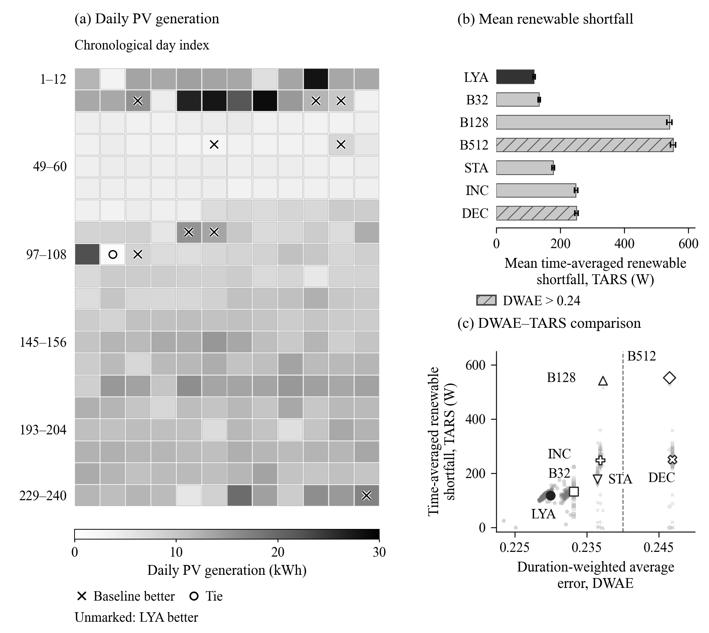
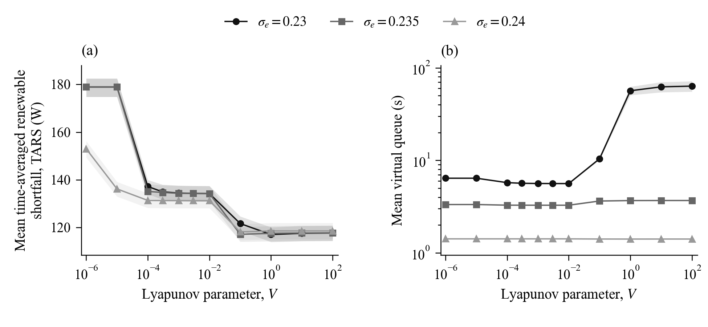
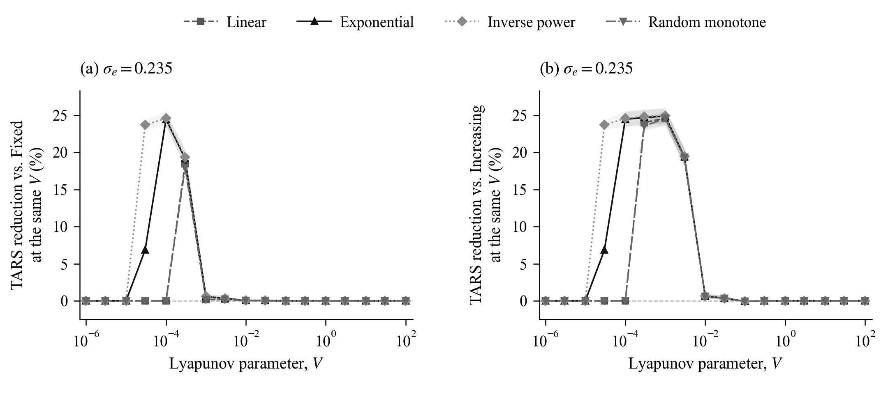

# Current Section 5.2 and 5.3 experiments — 2026-11-25

This is the current three-figure release for the **260K simulator**, using all 240 PV dates. Decision-side LYA uses only the three MLP means and the latest genuinely observed PV power times mean duration. The environment uses mean plus empirical joint noise and integrates PV over the realized epoch duration. Old information-mode experiments are historical dependencies, not current results.

| Section / figure | Code, results and explanation | Figure |
|---|---|---|
| 5.2: algorithm comparison, PV70 | [Experiment](260k-section52-mean-observed-pv/README.md) | [PDF](figures/section52_figure8.pdf) |
| 5.3: V versus TARS and virtual queue, panels a,b | [Experiment](260k-section53-v-mean-observed-pv/README.md) | [PDF](figures/section53_V_ab.pdf) |
| 5.3: decay versus Fixed and Increasing at the same V, panels a,b | [Composition and sources](260k-section53-weight-sameV-ab/README.md) | [PDF](figures/section53_weights_ab.pdf) |

## Section 5.2



Weights=(100,10,1), sigma_e=.24, selected V=.1. Across all 240 days, LYA mean TARS is 118.170992 W versus B32's 133.848036 W: 11.7126% lower. Six baselines and every date are retained.

## Section 5.3: V



Weights=(100,10,1); sigma_e=.23/.235/.24; 11 V settings. Some large-V runs at sigma_e=.23 violate the finite-window error target; the figure is a sensitivity study, not an entirely feasible Pareto frontier.

## Section 5.3: phase weights



Sigma_e=.235; all 17 V settings; four unchanged decay schedules versus Fixed=(100,100,100) and Increasing=(100,1000,10000). Benefits depend on V; all zero/negative effects remain. These figures do not establish universal dominance or superiority after separately tuning V. The two panels reuse the same decay runs, not independent repetitions.

## Full results and reproduction

The repository contains experiment/controller source code, frozen MLP/noise parameters, summaries, figure source tables and the three current figures. The [full release ZIP](https://github.com/gale13/SustainableAITraining/releases/tag/sections52_53_2026_11_25) additionally contains every saved run/daily checkpoint, calibration and sensitivity results, causal traces, the complete PV SQLite database, and required frozen historical input snapshots. No original experiment or former release is replaced.

After cloning, run from this directory:

```bash
python download_data.py
python -m pip install -r requirements.txt
python reproduce.py verify
python reproduce.py figures
```

Alternatively, extract the full release ZIP into a fresh directory and run the last three commands there. Python 3.10+ and a C++17 compiler (clang++ or g++) are required for simulations/verification. Plot regeneration requires Times New Roman, following the paper's established OR style; the supplied PDFs already embed all fonts. No GPU or server login is needed.

`python reproduce.py analyze` recalculates statistics and redraws the three figures from the saved runs without rewriting frozen raw inputs. Each experiment README lists its original simulation and independent verification commands. For fresh simulation experiments, use a separate copy and initialize a new protocol/cache chain: downstream protocols intentionally bind upstream artifacts by hash, so sequentially overwriting raw compressed archives in the release is not supported. Keep the supplied release intact for comparison. Re-analysis or redrawing changes generated-file hashes; run release integrity verification first or keep an untouched extracted copy.

All dates start at Asia/Shanghai 00:00; 30 tasks x4 epochs, 32 paired noise seeds per date. PV70 uses one fixed alpha=4.1928776597152995, calibrated on the original 48 days; the mean ratio across all 240 days is about 72.29%. Official unlimited-gap interpolation is explicitly inherited for this 240-day study. Missing observations, stale past power and model-calibration uncertainty remain limitations. See [PV usage](PV_DATA_USAGE.md).

Each original numerical result, MLP weight, noise-bank entry, source code file and figure is retained byte-for-byte. Publication changes only generalize irrelevant hardware/path metadata and refresh affected provenance checksums; details are in PUBLICATION.json. The full-data simulator uses all 600 profiling observations and is not a new held-out fit. Historical minimal snapshots are included only because current preparation and regression checks reference them.

`bundle_manifest.json` verifies the full package, `release_data.json` verifies its ZIP, and `RELEASE_VALIDATION.json` records isolated extraction verification. The separate original feasibility simulator and prior training archives in this repository remain unchanged.
