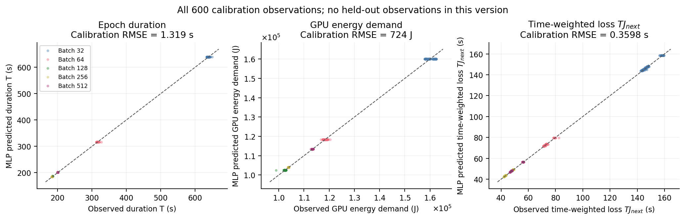
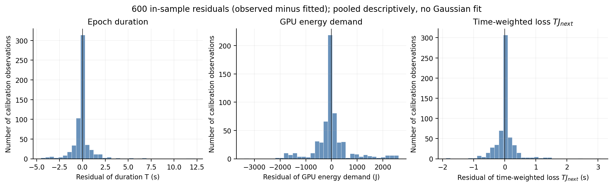
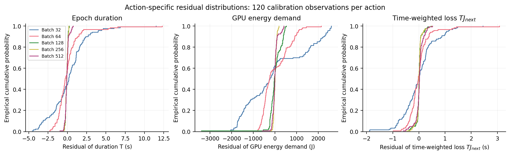

# Profiling 04 正式使用版：全量数据校准

本目录使用全部 **600 条 epoch 观测** 重新训练三个 MLP，并使用全部观测构建经验残差库。共 30 个配对随机种子 × 5 个 batch × 4 个 epoch，即 150 次训练 task。它用于实际运行模拟；独立留出验证的可行性实验证据保留在同级 `tinystories-04-simulator/`，对应 GitHub commit `9e379438019b951b1648fb27f28e3958c2b897f0`。该实验的全部文件校验值保存在 feasibility_snapshot_sha256.json，verify.py 已核对其未改变。

## 两个版本的职责

| 项目 | 保留的可行性实验 | 本目录：全量校准模拟器 |
| --- | --- | --- |
| MLP 拟合数据 | 原 train：360 条 | 全部 600 条 |
| 配置选择 | validation：120 条 | 固定已选配置，不重新搜索 |
| 噪声库 | validation：120 条 | 全部 600 条拟合后残差 |
| 每个 action/epoch 的 donor 数 | 6 | 30 |
| 独立 test | 120 条 | 无 |
| 误差含义 | 包含留出测试误差 | 仅全量校准误差 |

epochs.csv 中 original_split 保留原来的 train/validation/test 身份以便追踪；该列不用于任何筛选。三类原始观测均进入模型拟合和噪声库。calibration_role 对全部记录均为 full_data。

## 状态、模型及训练设置

状态仍为 s=(J,phi)，action 为 batch size，支持 32、64、128、256、512。J 是已完成 online train_loss 的任务内 running minimum，除以训练前实测初始 probe loss 加 1e-8；当前 epoch 的结果不会进入该 epoch 的决策输入。K=3、W=1，阶段阈值固定为 [-0.34015820570585115, -0.050537362338658506]，完全沿用可行性实验。初始 J 约为 1，默认初始 loss 使用全部 150 次 task 的初始实测值均值。也可传入实际初始 loss。

三个目标分别为 T（单轮训练时长，秒）、dem（GPU 训练窗口的需求能量，焦耳，不含 pv）、epsilon=T*J_next（秒）。输入仍为标准化 J、phase one-hot、action one-hot，共 9 维；J 及目标尺度在全量数据上重新计算。每个 MLP 一个 tanh 隐层，T、dem 使用正值输出；epsilon 输出限定在 (0,J*predicted_T)，直接拟合 T*J_next。

| metric | width | parameters | L2 | initialization_seed | iterations | converged |
| --- | --- | --- | --- | --- | --- | --- |
| T | 4 | 45 | 0.01 | 20261120 | 755 | True |
| dem | 16 | 177 | 0.01 | 20261119 | 1312 | True |
| epsilon | 16 | 177 | 0.0001 | 20261120 | 2327 | True |

网络宽度和 L2 沿用原验证集选定值；所有权重从头拟合。每个网络使用 20261119、20261120 两次初始化，按全量数据的正则化目标选较低者。优化为 L-BFGS-B，最多 6,000 次迭代、ftol=1e-11、gtol=1e-7；所有最终选中网络均收敛。epsilon 拟合使用已训练、冻结的 T 网络作为输出上界。详细记录见 optimization_runs.csv。

## 全量校准的最终误差

**以下所有指标均在参与拟合的 600 条数据上计算，不是 test loss，不能用来重新证明泛化效果。**

| metric | n | mse | rmse | mae | r2 |
| --- | --- | --- | --- | --- | --- |
| T | 600 | 1.7409772 | 1.319461 | 0.63855665 | 0.99994231 |
| dem | 600 | 524158.62 | 723.988 | 418.18182 | 0.99881532 |
| epsilon | 600 | 0.12947005 | 0.35981947 | 0.1898377 | 0.99991926 |

T、epsilon 的 RMSE/MAE 单位为秒，dem 为焦耳；对应 MSE 单位为秒²或焦耳²。metrics.csv 同时提供标准化 MSE 与含 L2 的优化目标，两者不可混用。分 action 指标见 metrics_by_action.csv。总体 R² 也包含不同 batch 的均值差异，不代表轮间微小波动已被准确预测。



## 噪声：全量经验残差抽样

noise_bank.npz 的形状是 **30 × 5 × 4 × 3**，分别对应配对 task 编号、action、epoch、三个共同抽取的残差成分。noise_library.csv 列出全部 600 个条目的实测值、预测、原单位残差、实际保存的比例残差及原始 split，便于逐条核查。

默认每轮均匀、有放回地从对应 action/epoch 的 30 个 donor 中重新抽一个，三个指标一起抽。没有拟合正态分布，也不通过一个 sigma 替代残差库。与可行性实验相同，内部采用相对残差和均值/物理边界校准；完整公式见 [EMPIRICAL_NOISE.md](EMPIRICAL_NOISE.md)。返回结果含 mean、noise 和 donor 来源，满足 outcome=mean+noise。noise_source 明确为 full_data_calibration。





noise_summary.csv 给出描述性均值、经验 SD、分位数、偏度和超额峰度。直方图合并所有 action 仅为展示，真正抽样仍按 action/epoch 分组，未删除任何异常值。

**本版本的噪声库来自参与 MLP 拟合的数据，因此误差幅度可能偏乐观。** 600 条观测来自 30 个种子，不是 600 次相互独立实验。更多 donor 可以覆盖更多已观测情况，不能补出未观测极端尾部；可行性验证结论仍以保留版本为准。固定 batch、固定 GPU 的原始实验也未验证任意 batch 切换后的真实训练动力学。

## 直接使用与重建

在本目录运行，推理只依赖 NumPy：

```python
from simulator import Simulator
sim = Simulator(seed=42)
rows = [sim.step(128) for _ in range(4)]
total_seconds = sum(r['T_s'] for r in rows)
total_energy_J = sum(r['demand_J'] for r in rows)
print(total_seconds, total_energy_J)
```

每次 task 四轮后调用 sim.reset()；默认每轮重新抽样。noise='trajectory' 可显式选用同一 donor 连续四轮的相关噪声敏感性模式；noise='none' 返回三个 MLP 均值。example_rollouts.csv 提供五种固定 action 各一次四轮模拟，仅为运行示例。

重建命令（本地 CPU 即可，不会启动原始 GPU 训练）：

```bash
python -m pip install -r requirements.txt
python fit.py
python verify.py
python report.py
```

verify.py 检查全部数据参与拟合、600 条噪声条目重构、状态因果顺序、所有 600 个实测状态的有限场景均值和物理边界、随机种子可复现以及可行性实验文件未变。结果见 verification.json。source.zip 是原始观测快照；calibration_recipe.json 固定了本次配置；checksums.json 记录本目录文件哈希。
