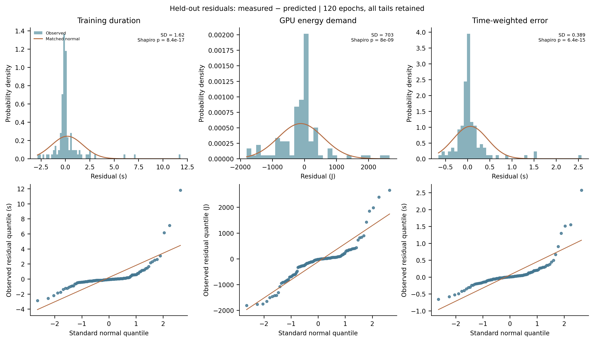
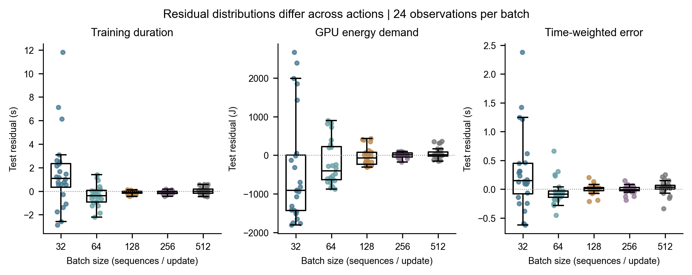
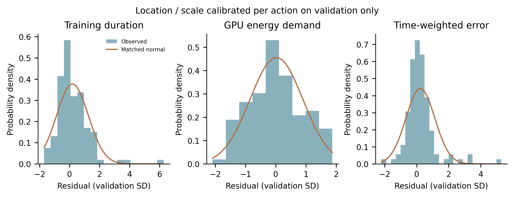
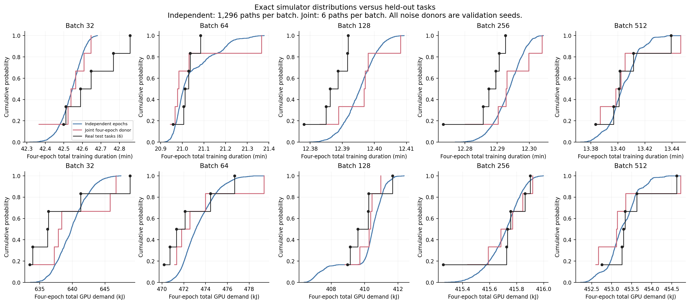

# 新版 Profiling 04：残差分布、动作差异与四轮联合噪声

本报告分析 online `train_loss` 状态版本；权重、阈值和 train/validation/test 划分均不因本报告而改变。对三个条件均值定义残差 eta_X = X - m_X(J,phi,a)。全部 120 个 test 点来自 6 个留出的配对 seed、30 条四轮轨迹。没有去除异常值或截断尾部。

## 主要判断

三个目标的总体残差均明显偏离一个共同加性正态分布，不能用一个已经验证的 Gaussian sigma 描述。下表 SD 是经验标准差。它包含外部波动、模型拟合偏差、初始种子影响以及压缩状态未覆盖的训练历史，不能直接称为纯外生随机性。

| metric | unit | mean | sd | sd_ci_low | sd_ci_high | q05 | q95 | skew | excess_kurtosis | shapiro_p |
| --- | --- | --- | --- | --- | --- | --- | --- | --- | --- | --- |
| T | s | 0.19851355 | 1.6165844 | 0.79346583 | 2.1865662 | -1.2498454 | 2.3157151 | 4.2024705 | 25.462445 | 8.4471711e-17 |
| dem | J | -114.66618 | 702.92799 | 473.71718 | 868.15884 | -1428.3814 | 840.84041 | 0.69768427 | 3.7887958 | 7.985884e-09 |
| epsilon | s | 0.063335905 | 0.38938257 | 0.20801604 | 0.52700796 | -0.3517174 | 0.50516568 | 3.3881204 | 17.203509 | 6.3715174e-15 |

SD 区间按整 seed 重采样 2,000 次，保留同 seed 的全部 action/epoch 配对。直方图覆盖所有点；橙线是匹配经验均值与 SD 的正态密度，不是拟合已获验证的噪声模型。Q–Q 图对比相同正态的分位数。



时长和时间加权 loss 右偏、厚尾；需求残差也有偏度和超额峰度。样本存在跨轮及配对依赖，Shapiro–Wilk 的 iid 前提不成立，因此其 p 值只作形状诊断，不能当作 120 次独立重复的严格显著性结论。三个总体检验的 Holm 校正数值也存入 noise_summary.csv。

## Action-independent 假设能否成立

各 batch 的原单位残差 SD：

| batch | T | dem | epsilon |
| --- | --- | --- | --- |
| 32 | 3.1872925 | 1409.7035 | 0.76043751 |
| 64 | 0.85727249 | 586.7575 | 0.24913482 |
| 128 | 0.14275242 | 237.55575 | 0.080711544 |
| 256 | 0.14944012 | 71.553647 | 0.072525712 |
| 512 | 0.29192739 | 150.36708 | 0.15676712 |

单位：T、epsilon 为秒，dem 为焦耳。原单位下，不同 batch 的分布/尺度明显不同。不能从所有 batch 的残差混合直方图提取一个 sigma，再假设该噪声对任何动作都适用。



只用 validation 为每个 action 估计残差均值、SD，再把 test 残差标准化。对 action 分布差异，按 seed 内交换完整四轮轨迹的 action 标签，共 4,999 次；统计量是七个共同分位点处的经验 CDF 差异。

| metric | scope | p | p_holm_three |
| --- | --- | --- | --- |
| T | raw | 0.0004 | 0.0008 |
| T | initial_state_only | 0.0002 | 0.0006 |
| T | validation_standardized | 0.0658 | 0.0658 |
| dem | raw | 0.0326 | 0.0326 |
| dem | initial_state_only | 0.072 | 0.144 |
| dem | validation_standardized | 0.0292 | 0.0584 |
| epsilon | raw | 0.0002 | 0.0006 |
| epsilon | initial_state_only | 0.1936 | 0.1936 |
| epsilon | validation_standardized | 0.0008 | 0.0024 |

raw 是原单位残差，initial_state_only 只看同一初始状态的第一轮，validation_standardized 是验证集标准化残差。新 epsilon 在标准化后仍显示动作间差异。T、dem 的部分校正结果没有超过常用阈值，这只是证据不足，不是 action independence 已成立。动作固定对应 GPU，实际执行时刻不同且没有随机交换 GPU；置换分数只能描述这些配对轨迹的差异，不能证明动作的因果效应。跨 epoch 的状态分布也会改变混合残差的形状。



## 能否提取一个真实的共同外生噪声

作描述性探索：对各 action 的 test 残差分别去均值，再把同 seed、同 epoch 的五个残差取均值。该均值只是共同成分的代理。它的方差包含各 action 独有噪声和拟合误差，不能直接当作共同外因的方差。进一步用另外四个 action 的平均残差预测当前 action，评估 leave-one-action-out skill（相对零预测）：

| metric | sd | mean_offdiagonal_covariance | loo_corr | loo_skill_vs_zero |
| --- | --- | --- | --- | --- |
| T | 0.56821527 | -0.14749836 | -0.14969071 | -0.33364102 |
| dem | 298.59165 | -9339.3453 | -0.039833085 | -0.27416303 |
| epsilon | 0.16685618 | 0.00096704808 | 0.014140238 | -0.24106813 |

三个 skill 都为负，未得到一个能够改善预测的共同加性成分。同 seed/epoch 也不意味着相同墙钟时刻，不足以识别同步外部扰动。公共模拟器不将这个描述性代理回填噪声库。

## 跨轮、跨目标相关性

按 action 计算相邻轮残差相关系数，每项只有 6 条轨迹、18 对相邻值；下表区间按整 seed bootstrap 2,000 次，样本很少，不能将高相关当成稳定规律。跨目标 Pearson 相关另见 residual_correlations.csv。

| metric | action | lag1_corr | seed_bootstrap_low | seed_bootstrap_high |
| --- | --- | --- | --- | --- |
| T | 32 | 0.36701092 | -0.41678104 | 0.87228096 |
| T | 64 | 0.41791323 | -0.037618459 | 0.61492563 |
| T | 128 | -0.34536889 | -0.76475944 | -0.090752679 |
| T | 256 | 0.05791081 | -0.75774298 | 0.47824239 |
| T | 512 | 0.68440576 | -0.36252533 | 0.86064116 |
| dem | 32 | 0.96229916 | 0.75804691 | 0.99368192 |
| dem | 64 | 0.9900311 | 0.88855954 | 0.9947909 |
| dem | 128 | 0.94999895 | 0.66284803 | 0.98602866 |
| dem | 256 | 0.46097028 | -0.23366394 | 0.64911356 |
| dem | 512 | 0.93463941 | 0.35233253 | 0.98701587 |
| epsilon | 32 | 0.14547209 | -0.38057398 | 0.73564013 |
| epsilon | 64 | 0.29545782 | -0.016095106 | 0.54343896 |
| epsilon | 128 | 0.2387428 | -0.27147042 | 0.63683912 |
| epsilon | 256 | -0.16256563 | -0.49813629 | 0.27061874 |
| epsilon | 512 | 0.36438156 | -0.015639881 | 0.66798956 |

## 模拟器中的可操作噪声表示

采用验证集实测残差的经验分布，只用 6 个 validation seed 的 120 条观测构成噪声库，不拟合参数分布。完整公式、mean + noise 表示及调用方式见 [EMPIRICAL_NOISE.md](EMPIRICAL_NOISE.md)。每条记录同时保存 T 的比例残差、dem 的比例残差、J_next/J 的保留率残差。三项一起抽取，保留本 epoch 的耦合关系；在同一状态下校准有限场景，使 E[T]、E[dem]、E[T*J_next] 恢复为三个 MLP 均值，并保证正时长、正需求、0<J_next≤J。

- **empirical（默认；independent 为兼容名称）**：每个 epoch 独立抽一个 validation seed 的对应 action/epoch 三元残差。下方图表中的 independent 就是该默认方式。
- trajectory（显式选用）：task 开始时抽一个 validation seed，连续四轮使用该 seed 的对应残差，用于相关噪声敏感性分析。
- pooled：混合 action 的对照方式，用于诊断；不作为 action-independent 已验证的证据。

**条件均值的边界：** 固定输入状态下，有限场景库的等权平均与 MLP 均值一致。逐轮独立抽样按这个分布抽取；但 trajectory 固定同一 donor 后，donor 会与已观测历史和当前状态相关，其后验分布不再必然均匀。因此不能把场景均值检查当作论文“给定完整历史仍只依赖 s,a”的证明。联合轨迹模式适合检验相关噪声下的表现；当前默认的 empirical/independent 在模拟器内满足该历史条件均值性质；这不构成真实数据的状态充分性证明。

随机 donor 索引的抽取概率可以与 action 无关，但从索引到实际扰动的映射仍依赖 action 和 epoch。因此这是“共同随机输入 + 动作相关响应”的经验表示，不能改写成已识别的同分布加性外生噪声。用户选择了经验残差方法；默认改为逐轮重新抽样，以保留 mean + noise 的条件均值解释，没有根据 test 结果挑选默认模式。测试数据不用于更新噪声库或校准。

## 单轮区间及四轮总量对比

条件场景的经验 5%–95% 区间在 test 上的覆盖率：

| mode | metric | coverage90 | width | n |
| --- | --- | --- | --- | --- |
| independent | T | 0.73333333 | 2.3694001 | 120 |
| independent | dem | 0.66666667 | 1355.9466 | 120 |
| independent | epsilon | 0.8 | 0.68310738 | 120 |
| pooled | T | 0.85833333 | 2.0705484 | 120 |
| pooled | dem | 0.86666667 | 2025.7815 | 120 |
| pooled | epsilon | 0.88333333 | 0.77495986 | 120 |

这些区间来源于只有 6 个 validation donor 的有限经验分布，不是有保证的预测区间。尾部不足、模型偏差或新环境会导致明显欠覆盖；不能宣称 90% 区间已经可靠校准。

为比较连续抽样是否更接近真实 task，总时长和总需求均累计全部四轮。independent 枚举全部 6^4=1,296 条路径，trajectory 枚举全部 6 条路径；每条路径递推 J、phi。两种方式都用 train 初始 loss 均值开始（J(0)≈1），不用 test 的未来数据。这样比较没有蒙特卡洛抽样波动。



下表按五个 batch 等权平均；CRPS 和 Wasserstein 越小越好，单位与总量一致（total_T 为秒，total_dem 为焦耳），coverage90 越接近 0.90 越好。

| metric | mode | crps | wasserstein | coverage90 |
| --- | --- | --- | --- | --- |
| total_T | independent | 1.8312195 | 2.0310542 | 0.7 |
| total_T | trajectory | 1.9055828 | 2.372902 | 0.76666667 |
| total_dem | independent | 1283.568 | 1105.2495 | 0.66666667 |
| total_dem | trajectory | 1154.909 | 792.45963 | 0.66666667 |

按逐 batch CRPS，联合抽样在时长上更接近实测的 batch 数为 2/5，在能耗上为 3/5。这里只描述这 6 个 test seed 的结果，不据此调参、修改噪声库或宣称普遍优于独立抽样。逐 batch 全指标见 task_distribution_scores.csv，所有有限路径及概率见 exact_task_distributions.csv，真实测试总量见 observed_test_task_totals.csv。

## 复现与文件

```bash
python diagnostics.py
python plots.py
python noise_analysis.py
python verify.py
```

`diagnostics.py` 计算残差、分布差异和基础模拟器检查；`plots.py` 绘制全部观测；`noise_analysis.py` 计算整 seed 的跨轮相关区间、枚举四轮分布并生成本报告。参数权重和验证集噪声库均保持重拟合版本。`noise_comparison.csv` 比较旧 probe 与新 online loss 的残差统计（若打包了旧统计）。

方法参考：[SciPy Shapiro–Wilk](https://docs.scipy.org/doc/scipy/reference/generated/scipy.stats.shapiro.html)、[SciPy Wasserstein distance](https://docs.scipy.org/doc/scipy/reference/generated/scipy.stats.wasserstein_distance.html)。这些是计算方法，不替代本报告对依赖观测、动作/GPU混杂和小样本的限制说明。
