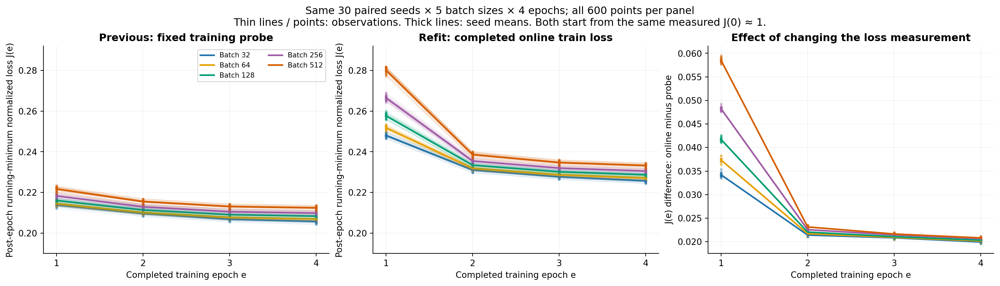
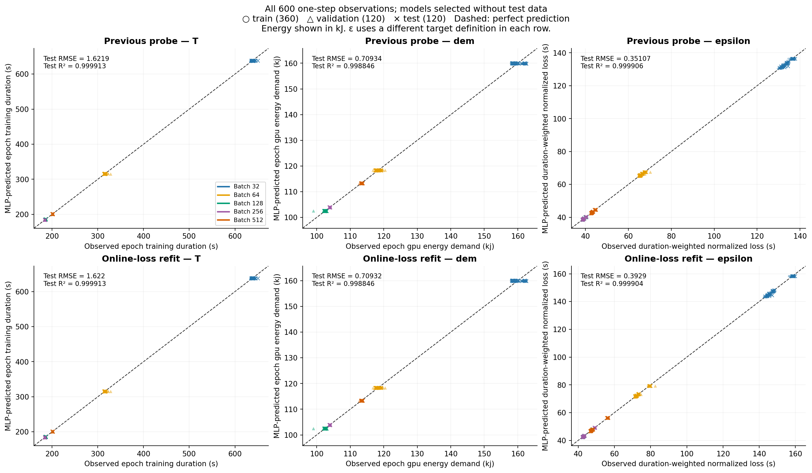
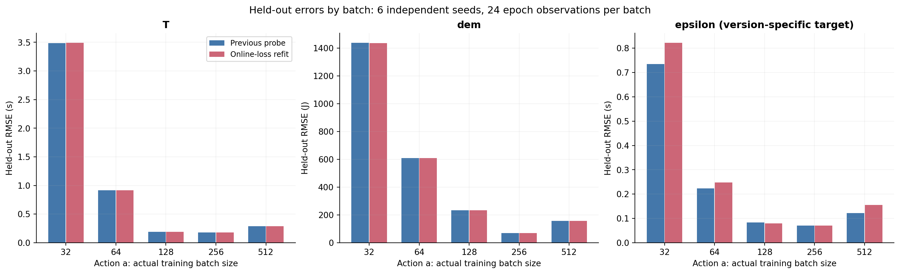

# Profiling 04：按论文递推、改用 epoch train_loss 的重拟合与对比

当前默认模拟器使用已完成 epoch 的 online train_loss，并保留训练前实测 loss 作为初始归一化基准。默认噪声采用[验证集实测残差经验抽样](EMPIRICAL_NOISE.md)，每轮重新成组抽样，不强行指定正态分布。[完整噪声分析](NOISE_REPORT.md) 包含直方图、Q–Q、分 action 残差、跨轮相关性以及四轮总时长/总需求的联合抽样对比。

## 结论及论文核对

核对的是当前目录中日期最新的主稿 `INFORMS_MNSC_final_1021/INFORMS-MNSC-Template.tex`，而非备份目录。定义映射、行号及 SHA-256 见 `MANUSCRIPT_MAPPING.md`、`provenance.json`。

原文第 310–319 行明确采用 normalized running minimum：

    J(r) = min_{r_j ≤ q ≤ r} hat_J(q) / (hat_J(r_j) + eps).

其中 hat_J(r) 是 epoch r 开始时已观测到的 training loss。第 322–333 行定义

    delta(r) = (J(r+1)-J(r))/(J(r)+eps),
    beta[k-1] < mean(last W_ma deltas) ≤ beta[k],
    phi(r_j)=1, phi(r+1)=max(phi(r),candidate_phase).

所以：是逐 epoch 的归一化历史最低 loss；phi 根据近期相对下降率分段，不根据剩余 J 的绝对大小分段。eps=1e-8。论文没有规定 hat_J 必须是日志的在线整轮平均值，也没有规定 12,800 条 probe。旧版也已经做了 running minimum；本次改变的是每轮采用的 loss 测量口径，而非首次加入 running minimum。

## 本次可复现的观测映射，以及“严格对齐”的边界

使用全部 600 条原始记录，没有重新训练语言模型或丢弃异常点。设 e=1,2,3,4 为日志轮号，r=e-1 为 task 内决策编号；c_e 为第 e 轮在线 train_loss；B 为同一 task 在任何训练更新前实测的初始 train_probe_loss。

    hat_J(0) = B
    hat_J(r) = c_r, r ≥ 1             # 在第 r+1 轮开始时已知
    J_before(e) = min(B,c_1,...,c_{e-1})/(B+eps)
    J_after(e)  = min(B,c_1,...,c_e)/(B+eps)

第 e 轮用 [J_before(e),phi_before(e),a] 预测本轮结果；c_e 只用于 J_after 和下一轮 phase，绝不进入本轮输入。末轮 J_after 是本 task 的末态，不能提前重置成下一 task 的 1。`epochs.csv` 保留 observed_loss_before/after、J、J_next、delta、phi、phi_next_within_task。

**初始测量限制：** 原数据没有初始“完整训练集、固定权重”loss，也不可能在尚未训练时有在线 epoch 均值。为保留全部四轮和真实初始状态，本次仅在归一化初始锚点 B 继续使用已保存的 probe。每轮结束的 probe 都不参与新版状态。用 c_1 反填初始值会把第一轮结果泄漏到第一轮决策，还使归一化尺度依赖第一个动作；用整条轨迹的最终 loss 做 min–max 归一化同样不符合论文。

**观测解释限制：** c_e 是不同 mini-batch、不同更新中权重的平均，能在下一轮开始时观测到，但不等于该时刻模型权重在固定训练集上的 loss。因此本版严格实现了论文的归一化、历史最小值、时间索引和阶段递推；“用在线均值作为 hat_J”的观测约定仍需在实验方法中说明，不能称为原文唯一指定的口径。若要求 hat_J 精确对应当前 checkpoint 的固定权重 loss，旧 probe 的测量方式更接近这一解释；现有日志不能补出全训练集的固定权重初始/端点 loss。

实际 150 条轨迹中，两种 loss 的相邻轮回升次数分别为 0、0。所以这份数据上 running minimum 没有触发截平；代码另用回升样例验证了截平逻辑。在线均值不能给单个 checkpoint 赋予同样的实测 loss，故不能凭本拟合宣称已经验证论文的 best-checkpoint 解释或状态充分性假设。

## 三个条件均值及计量范围

令 s=(J,phi)，a∈{32,64,128,256,512}：

    m_T(s,a)       = E[T | J,phi,a]
    m_dem(s,a)     = E[E_dem | J,phi,a]
    m_epsilon(s,a) = E[T * J_next | J,phi,a]

T=train_seconds，单位秒；E_dem=train_energy_j，单位焦耳；epsilon=T*J_next，单位秒。第三项严格按论文第 412–415 行的 b(x,y)=xy 构造每条观测，再直接回归乘积，并非 loss reduction，也不通过假设独立将两个条件均值相乘。m_dem 是需求部分，不是有 PV 时的 m_Es。

省略 xi 的条件是：本次只标定 GPU 训练需求和训练进展，假设同一供电/硬件条件下 PV 可用量不会直接改变这些结果；不拟合 renewable shortfall。时长和能耗都仅包括原始 GPU training 窗口，不包含预处理、验证、probe、存盘和机房其他耗电。在线 loss 版不再需要逐轮 probe，但本次没有擅自修改已经测得的 T、D 窗口。

## 阶段参数

继续用 K=3、W_ma=1；论文一般模型允许这两个参数，并未替 Profiling 04 指定数值。其附录其他工作负载的 K、beta 数字不是本数据的强制设置。四轮 task 下保留旧设置，也让对比只更换观测口径。阈值仍只取训练集前 3 轮、可用于后续决策的 270 个 delta 的 1/3、2/3 线性分位数，部署前冻结。

| 参数 | 旧 probe | 新 online train_loss |
| --- | --- | --- |
| beta_1 | -0.2792910736 | -0.3401582057 |
| beta_2 | -0.0169053761 | -0.0505373623 |
| 输入阶段路径 | [1,1,2,3] | [1,1,2,3] |

两版 600 个输入 phase 的不同记录数为 0；阶段 1/2/3 分别 300/150/150 点。这是校准约定，不是论文推出的最优阈值；本数据中分位数位于相邻阶段降幅之间的空隙，具体数值不宜赋予物理最优性。J、phi、epoch 关联很强，无法独立识别 phase 的因果贡献。



## 相同的数据划分与训练流程

语言模型种子为 1337–1366；同一 seed 的五个 batch 和四轮成组划分。模拟器划分和原版完全相同，六个连续 task 区间内各分配 3/1/1 个 seed，分析随机种子 20261119：

- Train：18 seed、360 点；tasks [2, 4, 5, 6, 7, 9, 12, 13, 14, 18, 19, 20, 22, 23, 25, 26, 27, 28]。
- Validation：6 seed、120 点；tasks [1, 8, 11, 17, 21, 30]。
- Test：6 seed、120 点；tasks [3, 10, 15, 16, 24, 29]。

这些集合是用于拟合模拟器的 epoch 观测划分，不是语言模型的训练/验证文本划分。输入标准化、阈值和权重只用 train；validation 选择隐藏宽度及 L2；test 不参与任何选择。没有在 train+validation+test 上重拟合。

3 个单隐层 tanh MLP，输入 [标准化 J,onehot(phi),onehot(a)] 共 9 维。a 是实测的五个离散动作，不外推未测 batch。输出参数化与旧版完全相同：

    h_X = tanh(x W_X+b_X)
    m_T = c_T softplus(h_T v_T+b_T_out)
    m_dem = c_D softplus(h_D v_D+b_D_out)
    m_epsilon = J * m_T * sigmoid(h_epsilon v_epsilon+b_epsilon_out)

最后一个网络单独优化，训练时 T 网络冻结，标签始终为逐点 T*J_next。该界来自 J_next≤J，并不假设 T 与 J_next 独立。c_T,c_D 为 train 标签均值。

隐藏宽度候选 4/8/16，L2 候选 1e-4/1e-2；每项用 20261119、20261120 两个初始化，按训练目标选初始化，再按验证 MSE 选网络。L-BFGS-B 最多 1800 次，目标=按 train 标签 SD 缩放的 MSE + 权重均方 L2。

| target | width | parameters | L2 | optimization_loss | iterations | converged |
| --- | --- | --- | --- | --- | --- | --- |
| T | 4 | 45 | 0.01 | 0.0010049689 | 603 | True |
| dem | 16 | 177 | 0.01 | 0.0012480983 | 1238 | True |
| epsilon | 16 | 177 | 0.0001 | 7.034111e-05 | 1682 | True |

所有选中网络均收敛；搜索中未收敛的候选保留在 model_selection.csv。旧 epsilon 网络曾到达同一 1800 次上限，旧结果原样保留。

新版原单位 loss（MSE，不含正则）及预测误差：

| metric | split | n | mse | rmse | mae | r2 |
| --- | --- | --- | --- | --- | --- | --- |
| T | train | 360 | 1.2129577 | 1.1013436 | 0.59310153 | 0.99995977 |
| T | validation | 120 | 2.5611169 | 1.600349 | 0.71539194 | 0.99991492 |
| T | test | 120 | 2.6309748 | 1.622028 | 0.72296743 | 0.99991328 |
| dem | train | 360 | 518713.01 | 720.21733 | 418.78744 | 0.99882751 |
| dem | validation | 120 | 578078.41 | 760.31468 | 431.80723 | 0.99871226 |
| dem | test | 120 | 503138.53 | 709.32258 | 436.0975 | 0.99884629 |
| epsilon | train | 360 | 0.1049344 | 0.3239358 | 0.18153958 | 0.99993449 |
| epsilon | validation | 120 | 0.18656788 | 0.43193504 | 0.22165458 | 0.99988319 |
| epsilon | test | 120 | 0.15436673 | 0.39289532 | 0.19731779 | 0.99990443 |

## 测试集对比

| version | metric | rmse | mae | r2 | action_only_rmse | rmse_over_target_mean_pct |
| --- | --- | --- | --- | --- | --- | --- |
| probe_previous | T | 1.62189 | 0.7229863 | 0.9999133 | 1.5989524 | 0.53135659 |
| probe_previous | dem | 709.33909 | 436.00359 | 0.99884624 | 703.82746 | 0.59356694 |
| probe_previous | epsilon | 0.35106519 | 0.17231025 | 0.99990571 | 1.1631787 | 0.54534946 |
| online_train_loss | T | 1.622028 | 0.72296743 | 0.99991328 | 1.5989524 | 0.53140181 |
| online_train_loss | dem | 709.32258 | 436.0975 | 0.99884629 | 703.82746 | 0.59355313 |
| online_train_loss | epsilon | 0.39289532 | 0.19731779 | 0.99990443 | 3.7520522 | 0.54336027 |

T 和 E_dem 的真实标签完全相同，测试误差几乎不变。两版 MLP 对 T、D 均未超过仅按 action 取训练均值的基线；总体 R² 很高主要反映 batch 之间的巨大差别，不能解释为 epoch 微小随机性已被准确预测。

**epsilon 的原始 RMSE 不是同一目标上的竞赛：** J_next 口径改变后，epsilon 标签也改变了。新版全体 epsilon 平均水平增加 12.323%。所以只能把各自 RMSE、R²、相对平均值的 RMSE 视为各自定义下的拟合质量；不能直接由 0.351 与 0.393 秒判断哪个 loss 口径“更正确”。旧模型只能按旧状态和旧标签评价；本报告没有把旧参数喂进新状态后冒充公平对比。





## 使用、验证及适用范围

`models.json` 保存全部参数，`model_config.json` 保存尺度、阈值、种子、拆分；`simulator.py` 提供 means/step。**默认 `empirical`：逐轮从验证集的对应 action/epoch 实测残差中成组抽取三个指标，不指定正态分布。** `independent` 是兼容旧名称；`trajectory` 仅作为显式选用的相关噪声分析。噪声库仅含 6 个 validation seed 的 120 条观测，test 仅评估。相对残差、均值校准、物理约束及完整公式见 [经验噪声说明](EMPIRICAL_NOISE.md)。返回值包含三个 mean、三个 noise 和验证集 donor 来源，便于逐条核查。

```python
from simulator import Simulator
sim = Simulator(seed=42)
sim.reset(initial_loss=6.240367221832275)  # 可传实际 task 的初始测量
print(sim.means(sim.J, sim.phase, 128))
rows = [sim.step(128) for _ in range(4)]  # 默认经验残差抽样，每轮重新抽取
```

原始五组全部固定 batch，且每个 batch 固定一张 GPU。测试只能评估相同语料、硬件组合、已测动作下对新种子的泛化；它不能验证任意 batch 切换政策下的状态充分性，batch 与 GPU 的影响也未被分开。切换后的优化器状态、学习率历史等可能未被 J、phi 完全描述。默认初始 loss 取 train 集均值；显式传入实际初始值可精确复现其 J(0)。

在本目录运行以下命令可再现，不使用服务器 GPU：

```bash
python fit.py
python diagnostics.py
python plots.py
python noise_analysis.py
python verify.py
python compare.py
```

环境版本见 environment.json；依赖见 requirements.txt。verify.py 校验因果输入、独立标量递推、loss 回升截平、阶段边界、整 seed 拆分、train-only 阈值、MLP 导出、三目标一致性、模拟器均值和边界，并核对历史对比参考数据的 SHA-256。实际运行结果见 verification.json。

本目录保留全部原始 snapshot source.zip、仅含数值表和阈值的对比参考数据 comparison_reference/、600 条新状态、逐点差异、全套指标和三种格式的图。本地只保留当前模拟器；旧模型权重及旧模拟器副本已清理。历史对比数据仅用于重现对比结果。
