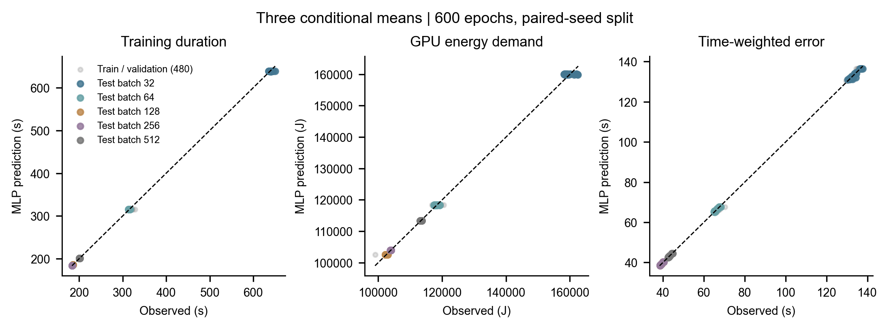
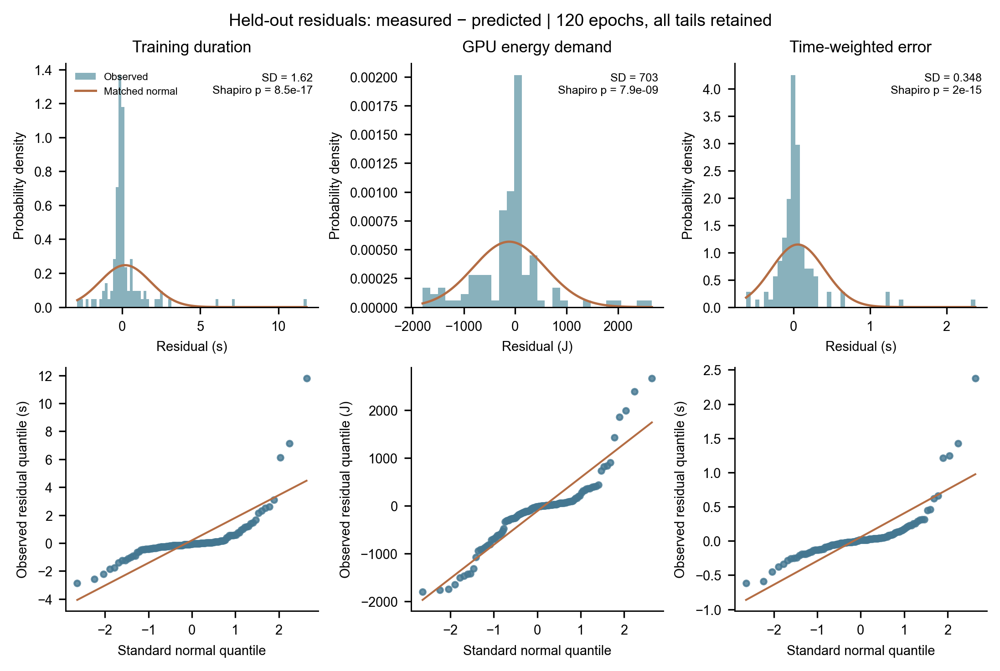
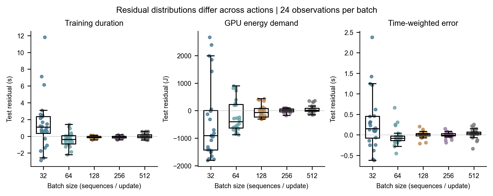
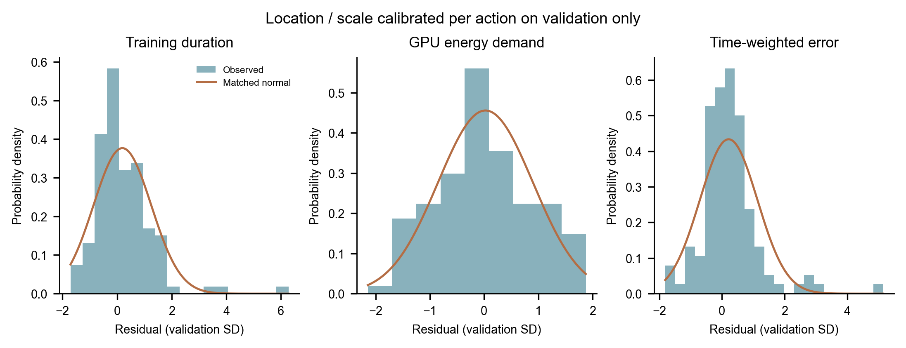

# Profiling 04：三个条件均值 MLP 与经验噪声模拟器

本版使用全部 5 batch × 30 task × 4 epoch = 600 个正式观测。5 个动作是 32、64、128、256、512。原始快照 source.zip 保留逐 epoch 表、每个 task 的初始 loss、种子、完成信息、配置与训练脚本。本版没有排除异常点；快照未发现 GPU overlap 事件，五组均只启动一次、失败次数为 0。

## 定义与信息边界

一项 task 是同一个模型从随机初始化开始完整训练 4 个 epoch。实验种子 1337–1366；task t 对应 seed=1336+t，同编号跨 batch 共用初始化权重和各轮数据排列，已逐项核验哈希。

采用论文的决策前状态 s=(J(r),φ(r)) 和 a=batch size。令 L(r) 为固定 12,800 条训练序列在当前权重、eval 模式下测得的 train_probe_loss；L(0) 是本次 task 的实测初始值。定义

    J(r) = min{L(0),...,L(r)} / (L(0)+1e-8)

日志第 e 轮的 J 输入来自第 e−1 轮结束后的状态，第一轮来自初始探针。J_next 是第 e 轮结束后的 running minimum。验证语料 loss 不参与 J；train_loss 是在线整轮均值，保留在表里但不用于构造决策前状态。这避免把当前轮结果泄入当前轮输入。

拟合的三个函数为：

- m_T(J,φ,a)=E[T | J,φ,a]，T 是 train_seconds，单位秒。
- m_dem(J,φ,a)=E[D | J,φ,a]，D 是同一训练窗口的单卡 train_energy_j，单位焦耳；除以 3,600,000 得 kWh。仅拟合需求，不包含 PV，也不将需求直接称作可再生能源短缺。
- m_ε(J,φ,a)=E[T×J_next | J,φ,a]，单位秒。每个 epoch 先计算 T×J_next 再拟合；它不是原始 CE，也不是单独的 loss 降幅。

范围与前两版一致：训练 GPU 窗口，不包括数据准备、编译、完整验证、训练探针、checkpoint 写盘及机房其他用电。原始表另有验证/探针/整轮开销，未丢弃。

## 阶段标定

沿用论文的近期相对下降率定义，而不是将剩余 J 阈值当作同一概念。每个 task 只有 4 轮，使用 K=3、W_ma=1。旧的三轮滑动窗口会让绝大多数决策停留在初始阶段。对于 δ(r)=(J_next−J)/(J+1e-8)，候选阶段落在 (β[k−1],β[k]]；阶段取历史最大值，task 初始阶段为 1。

两条内部 β 取训练集前 3 轮 δ 的 1/3、2/3 分位数（只有这些下降率会用于后续决策），不使用验证或测试数据。固定阈值后所有集合共用。

β=(-∞, -0.279291074, -0.016905376, 0)，即约 −27.9291%、−1.69054%。600 个输入状态的阶段计数为 300、150、150。由于 J 和阶段在这 4 轮中高度相关，本实验不能单独识别 φ 相对于 J 的贡献。

## 数据划分

这里的 train/validation/test 是模拟器的观测划分，区别于原始语言模型使用的训练/验证文本。按 task seed 整组划分，同一个 seed 的五种动作和全部四轮始终在同一集合。将 task 1–30 分成六个连续时间区间，每区间五个 seed 按分析种子 20261119 打乱，分配 3 train、1 validation、1 test，避免某集合只覆盖早期或晚期。

| 集合 | 独立 seed 数 | 训练轨迹数 | epoch 点数 | task 编号 |
| --- | --- | --- | --- | --- |
| train | 18 | 90 | 360 | 2, 4, 5, 6, 7, 9, 12, 13, 14, 18, 19, 20, 22, 23, 25, 26, 27, 28 |
| validation | 6 | 30 | 120 | 1, 8, 11, 17, 21, 30 |
| test | 6 | 30 | 120 | 3, 10, 15, 16, 24, 29 |

训练集拟合权重和输入尺度；验证集选择隐藏宽度及 L2，并提供噪声库；测试集只用于最终评估与残差诊断。最终模拟器保留这些训练集权重，没有用测试集重拟合或校准噪声。测试回答的是同一语料、硬件和已测动作下对新初始化种子的泛化。

## 网络、训练目标与最后的 loss

输入 x=[标准化 J, onehot(φ), onehot(a)]，共 9 维。每个 MLP 一个 tanh 隐层。令 h_k=tanh(W_k x+b_k)：

    m_T   = c_T softplus(v_T h_T+b_T)
    m_dem = c_D softplus(v_D h_D+b_D)
    m_ε   = J × m_T × sigmoid(v_ε h_ε+b_ε)

第三个 MLP 独立优化，时长网络在此时被冻结；训练标签仍是逐点 T×J_next，直接最小化该最终输出的 MSE。这个参数化保证 0<m_ε<J m_T。它没有假设 T 与 J_next 独立。c_T、c_D 为训练集标签均值。

候选隐藏宽度 4/8/16，L2=1e-4/1e-2；每种配置使用 20261119、20261120 两个初始化，先按训练目标取更好的初始化，再按验证集原单位 MSE 选配置。L-BFGS-B 每次最多 1800 步，目标为标准化 MSE + 对 W、v 的均方 L2 惩罚。输入的均值、SD 及全部参数见 model_config.json、models.json。

| 目标 | 隐藏单元 | 参数数 | L2 | 最终优化目标（含正则） | 优化步数 | 停止状态 |
| --- | --- | --- | --- | --- | --- | --- |
| T | 4 | 45 | 0.01 | 0.0010049801 | 864 | 收敛 |
| dem | 16 | 177 | 0.01 | 0.0012480639 | 1348 | 收敛 |
| epsilon | 16 | 177 | 0.0001 | 7.2134779e-05 | 1800 | 达到预设迭代上限 |

以下 MSE 不含正则；RMSE 为 MSE 的平方根，与目标同单位。三个不同量纲的优化目标不应直接比较。

| 目标 | 集合 | n | MSE | RMSE | MAE | R² |
| --- | --- | --- | --- | --- | --- | --- |
| T | train | 360 | 1.2131295 | 1.10142 | 0.593153 | 0.999960 |
| T | validation | 120 | 2.5610972 | 1.60034 | 0.715368 | 0.999915 |
| T | test | 120 | 2.630527 | 1.62189 | 0.722986 | 0.999913 |
| dem | train | 360 | 518724.06 | 720.225 | 418.84 | 0.998827 |
| dem | validation | 120 | 578313.17 | 760.469 | 431.68 | 0.998712 |
| dem | test | 120 | 503161.94 | 709.339 | 436.004 | 0.998846 |
| epsilon | train | 360 | 0.087630528 | 0.296025 | 0.166199 | 0.999932 |
| epsilon | validation | 120 | 0.14551609 | 0.381466 | 0.197776 | 0.999887 |
| epsilon | test | 120 | 0.12324677 | 0.351065 | 0.17231 | 0.999906 |

只按 action 取训练均值的简单基线，其测试 RMSE 分别为 1.59895 s、703.827 J、1.16318 s。MLP 在时长和能耗上没有超过这个基线，在时间加权误差上从 1.16318 s 降至 0.351065 s。总体 R² 很高，主要因为不同 batch 的均值差异大；不要据此认定微小噪声已被准确解释。metrics_by_action.csv 给出各 batch 内部误差。



## 残差形状及 action independence

定义 η_X=X−m̂_X(J,φ,a)。以下只用 120 个留出点，来自 6 个独立 seed、30 条四轮轨迹。残差包含环境扰动、模型拟合偏差及压缩状态未包含的信息，不能直接等同于纯外生噪声。

所有点和尾部都保留。直方图叠加与样本均值、SD 匹配的正态密度；Q–Q 图与该正态的理论分位数比较。Shapiro–Wilk 的原假设为正态分布，参见 [SciPy 文档](https://docs.scipy.org/doc/scipy/reference/generated/scipy.stats.shapiro.html)。相邻轮和配对动作并不独立，以下 p 只作形状诊断，不能当作 120 次独立重复的精确推断。三项总体形状检验的 Holm 校正 p 也保存在 CSV。

| 残差（单位） | 均值 | 经验 SD | SD 的 95% seed-bootstrap 区间 | P5 | P95 | 偏度 | 超额峰度 | Shapiro p |
| --- | --- | --- | --- | --- | --- | --- | --- | --- |
| T (s) | 0.198809 | 1.61641 | [0.7931, 2.186] | -1.25 | 2.3129 | 4.202 | 25.46 | 8.5e-17 |
| dem (J) | -114.669 | 702.944 | [473.7, 868.2] | -1426.2 | 837.82 | 0.6987 | 3.791 | 7.87e-09 |
| epsilon (s) | 0.0561772 | 0.347994 | [0.1801, 0.4723] | -0.25907 | 0.46807 | 3.599 | 19.32 | 1.99e-15 |

SD 区间由整 seed 重采样 2000 次得到，保留同 seed 的五种动作和四轮。只有 6 个测试 seed，区间仍不稳定。上表 SD 是经验离散程度，不是已经得到验证的共同高斯 σ。三项合并残差都不适合一个统一高斯；T、ε 尤其右偏、长尾。



不同 action 的经验 SD：

| Batch | 时长 SD (s) | 能耗 SD (J) | ε SD (s) |
| --- | --- | --- | --- |
| 32 | 3.18673 | 1409.81 | 0.681539 |
| 64 | 0.85755 | 586.717 | 0.223725 |
| 128 | 0.142391 | 237.398 | 0.0853386 |
| 256 | 0.149623 | 71.9218 | 0.071109 |
| 512 | 0.292677 | 150.34 | 0.121773 |

检验动作间分布差异时，在每个 seed 内交换五条完整四轮轨迹的 action 标签，保持时间关联；以共同七个分位点处 CDF 差异为统计量，进行 4999 次置换。另作第一轮对照（相同初始状态）和按验证集逐 action 均值、SD 标准化后的比较。原始五个 GPU 与 batch 一一固定、执行墙钟时刻不同，置换只刻画 action/GPU 组合之间的分布差异，不能证明 action 是差异的因果来源。加一校正与配对检验思路见 [SciPy 文档](https://docs.scipy.org/doc/scipy/reference/generated/scipy.stats.permutation_test.html)。

| 目标 | 比较范围 | 置换 p | 三指标 Holm 校正 p |
| --- | --- | --- | --- |
| T | raw | 0.0004 | 0.0008 |
| T | initial_state_only | 0.0002 | 0.0006 |
| T | validation_standardized | 0.0658 | 0.0658 |
| dem | raw | 0.0326 | 0.0326 |
| dem | initial_state_only | 0.1474 | 0.2948 |
| dem | validation_standardized | 0.0292 | 0.0584 |
| epsilon | raw | 0.0002 | 0.0006 |
| epsilon | initial_state_only | 0.2602 | 0.2948 |
| epsilon | validation_standardized | 0.0036 | 0.0108 |

原尺度的统一加性噪声假设不受支持。按验证集逐 action 标准化后，T 的动作差异 p=0.0658，能耗 p=0.0292（Holm 后 0.0584），ε p=0.0036（Holm 后 0.0108）。T、ε 标准化残差仍明显非正态；能耗标准化残差 Shapiro p=0.277，在本次小样本上与正态相容。因此“能耗=均值+动作相关尺度×共用近似正态变量”可以作为敏感性分析近似，但不能据未拒绝检验就宣称严格独立。每个动作的标准化参数仅来自验证集。




进一步对同一 seed、同一 epoch 的五个去动作均值残差取平均，得到 24 个共同成分代理。其 SD 为 0.568 s、298.593 J、0.148 s；但用其余四个动作的均值预测本动作时，三个指标的误差均高于零预测。对应平均非对角协方差为 −0.1475 s²、−9350 J²、0.000380 s²。没有稳健证据从这些记录中识别出一个共同外生加性冲击，不能把代理的 SD 当成 action-independent σ。共同代理直方图、留一动作诊断、残差相关矩阵和逐动作 lag-1 相关均随包保存。匹配 seed/epoch 也不是匹配同一墙钟时间。

## 已实现的模拟器

推断只依赖 NumPy。三个 m 的权重保留训练/验证评估版本；不使用测试噪声校准。噪声库由 6 个验证 seed 的完整 4 轮、5 个 action 构成，保存同轮的 T 比例、D 比例与 J 保留率残差，保留跨指标关联。

- trajectory（默认）：每个模拟 task 在验证 seed 中选一条，连续四轮沿用同一 donor。按 action/epoch 读取该条轨迹的扰动，保留可观测的跨轮关联。
- independent：每个 epoch 重新选择 donor，仍同时抽取三个相关结果。
- pooled：在对应 epoch 混合五种动作的标准化扰动库，用于比较共用噪声形状这一近似。
- none：输出条件均值，并令 J_next=m_ε/m_T。注意这个比值是时间加权的状态均值，一般不等于 E[J_next]。

对每个状态和动作，候选场景分别校准时长和能耗均值，再校准有界的 J 保留率，使单步枚举场景均值与三个 m 一致，且 T,D>0、0<J_next≤J、ε=T×J_next。已在所有测试状态验证这些约束。trajectory 保留 donor 后，当前 J 与 donor 会相关，因此该逐点校准不意味着整个相关过程仅给定 (J,φ) 就严格满足同一条件均值；它是复现序列关联的经验近似。

用留出集检查 validation-only 的单步 90% 经验区间，independent 的覆盖率仅为 T 73.3%、D 66.7%、ε 79.2%；pooled 分别为 85.8%、86.7%、90.0%。每个 action/epoch 只有 6 个校准样本，尾部区间偏窄，这一版能跑通模拟，但不应称作已校准的 90% 预测区间。没有为提高覆盖率而使用测试数据扩宽区间。

```python
from simulator import Simulator
sim = Simulator(seed=42)
print(sim.means(J=1.0, phase=1, action=128))
for _ in range(4):
    print(sim.step(128, noise='trajectory'))
sim.reset()  # 新 task
```

只接受五个已测 action。中途换 batch 的代码可执行，但正式数据只有固定 batch 轨迹，尚未验证切换后优化器历史和学习率状态的因果影响。该模拟器是同一任务族的经验近似，未验证新数据集、新 GPU 或未测 batch 的泛化；J、φ 是否足以构成 Markov 状态也未由此次拟合证明。

## 复现与文件

```bash
python fit.py
python diagnostics.py
MPLCONFIGDIR=/tmp/mpl-profile04 python plots.py
```

环境：Python 3.11.4、NumPy 1.26.4、pandas 3.0.1、SciPy 1.11.3、Matplotlib 3.8.0、threadpoolctl 3.2.0。版本记录是本机实际运行环境，不要求这些版本作为新的最小兼容组合。

- source.zip：冻结的原始观测；epochs.csv：600 行状态、划分、目标、预测与残差。
- models.json、model_config.json、model_selection.csv：权重、种子/阈值/划分、全部候选验证结果。
- metrics.csv、metrics_by_action.csv：原单位最终误差及动作内误差。
- noise_summary.csv、action_tests.csv、standardized_noise.csv、common_component.csv：噪声与独立性诊断。
- noise_bank.npz、simulator.py：可直接调用的模拟器及验证集经验库。
- heldout_rollouts.csv、simulation_samples.csv、interval_coverage.csv：四轮回放、模拟样本、覆盖率。
- 五组图均提供 PDF/SVG 可编辑矢量与 PNG 预览；没有截断残差尾部或删点。

图形 QA：定量网格、182.9 mm 宽、统一单位、全部观测可追溯；随机数仅用于箱线图横向错开观测点，未生成实验数据。自动检查无 FAIL，PNG 采用 300 dpi 预览而非 TIFF 投稿栅格，PDF/SVG 为主输出。已人工检查排版和坐标。更详细的合规期刊尺寸应在投稿时再核对。
